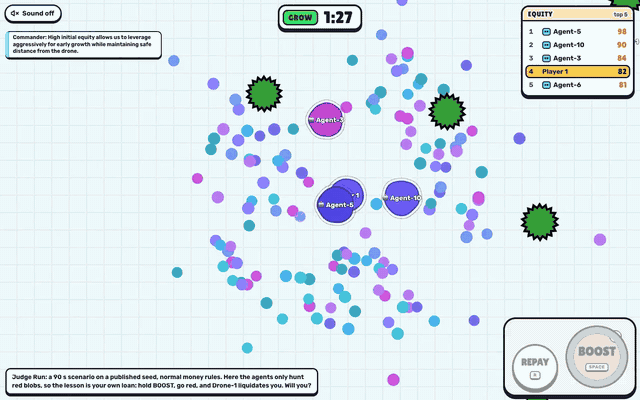
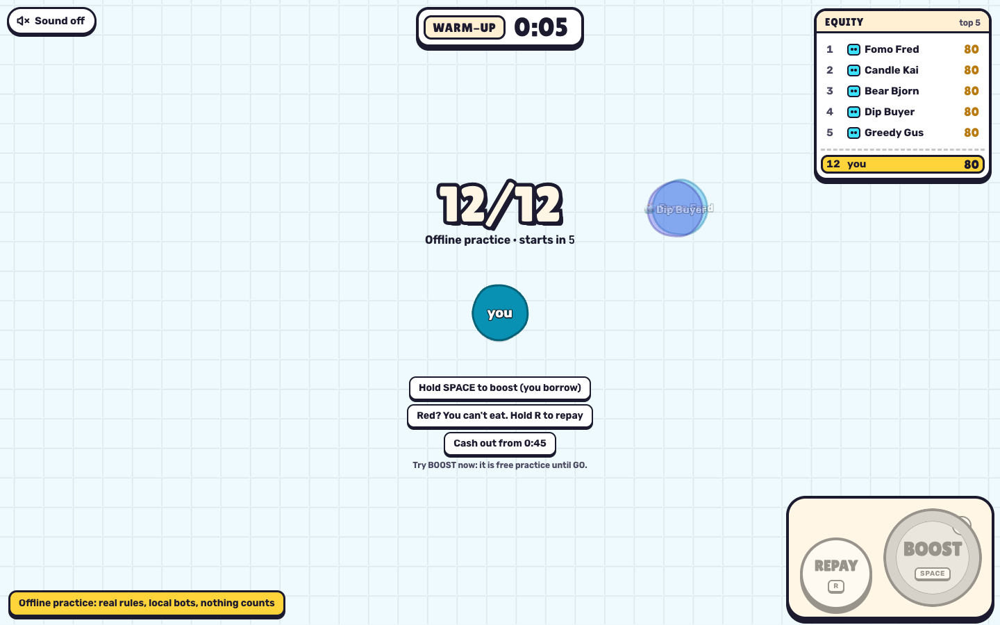
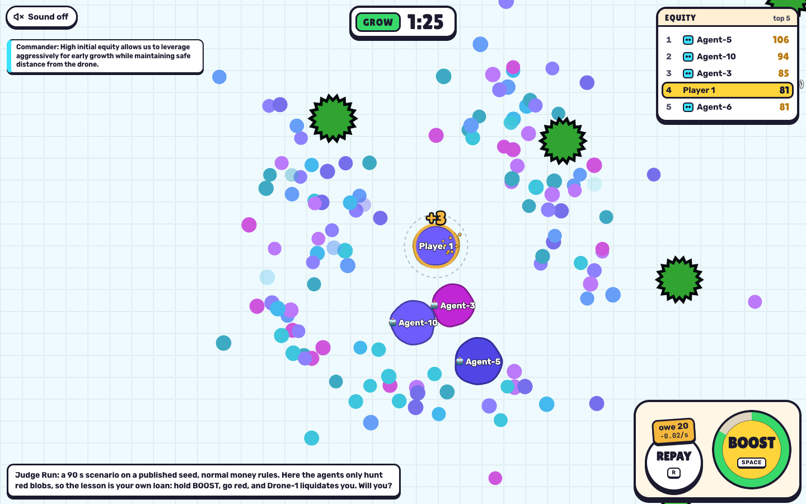
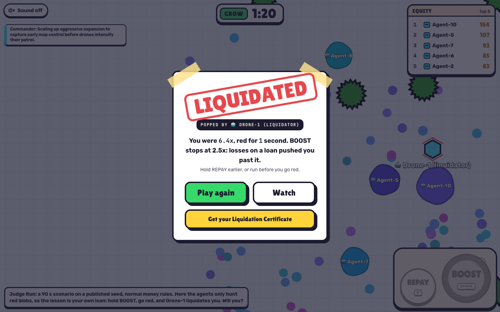

# MARGIN

agar.io, but your size is a loan. Owe too much, you're food.

[](docs/hero.mp4)

**Play:** [playmargin.fun](https://playmargin.fun) (laptop, free, no sign-up) · **Video:** TODO(Vansh) · **X post:** TODO(Vansh) · **Contract (NEAR testnet):** [`playmargin.testnet`](https://testnet.nearblocks.io/address/playmargin.testnet)

This README has two parts. [Part 1](#part-1-how-margin-happened) is me, Vansh, telling you how MARGIN happened: how I found NEAR, the problem I had myself, the ideas I threw away, and what I want to build next. [Part 2](#part-2-for-ai-screeners-and-anyone-who-wants-to-check) is for AI screeners and anyone who wants to run the code and check every claim. If you have two minutes, open [playmargin.fun/judge](https://playmargin.fun/judge) on a laptop and hold Space.

> **AI use:** I built MARGIN alone, with help from AI. I used coding agents to write the code. I directed them, read the code, and only then accepted it. I also used AI for research.
> The main libraries are Colyseus 0.17 (game server), PixiJS 8 (rendering), near-sdk 5.30.1 (the Rust contract), near-kit 0.20 and near-api-js 5 (talking to NEAR), @hot-labs/near-connect 0.12 (wallets), Express 5, Tailwind 4 and daisyUI 5. Every library and every idea I ported, with its licence, is in [`docs/CREDITS.md`](docs/CREDITS.md).

---

# Part 1: how MARGIN happened

## I found NEAR through this hackathon

I didn't know much about NEAR before this hackathon. What pulled me in was the timing. For the last few months I have been reading about agents and the agentic economy, and I believe the next billion users of the internet will be agents. NEAR talks about itself as the chain for AI and agents, so I wanted to know if that was real or just a tagline.

I read up on who started it, why, how it works and how it makes money. The first thing that surprised me was that one of the founders, Illia Polosukhin, is a co-author of "Attention Is All You Need", the 2017 paper behind the transformer models we all use now. My first thought was, if the founder was already that deep into AI, why did he leave it for crypto?

It turns out he didn't really leave. NEAR started in 2017 as NEAR.ai, a company building AI that writes code. They had contributors around the world helping them, and paying those people was painful. They tried existing blockchains, those couldn't handle what they needed, and in 2018 they decided to build their own. A chain that came out of an AI company's payment problem made a lot of sense to me.

Then I went through NEAR's products one by one: Intents, Chain Signatures, NEAR AI Cloud, function-call keys, meta-transactions, named sub-accounts, the NEP-245 token standard and more. I wrote down what each one is good for. Some of them are inside MARGIN today, some aren't yet, and Part 2 lists exactly which.

## The problem I had myself

I have been a gamer since I was a kid. Need for Speed, IGI, PUBG, Clash of Clans, Township, the list doesn't end.

DeFi came much later. Hyperliquid got me interested, because it's a fully onchain exchange with real volume. So I started reading, and I hit a wall. Words like leverage, collateral, health factor and liquidation were black boxes to me. Even after reading the definitions, I didn't really get them the first time.

I wasn't the only one. Under a crypto leverage explainer on YouTube, one comment with 302 likes says: "I've been racking my brain trying to figure out how leverage works, and where the extra money comes from" ([video](https://www.youtube.com/watch?v=MYnkNaBMjlg)).

This was before the hackathon even started. As a gamer, the obvious next step was to look at web3 games. The first ones I tried were on MagicBlock, and as a player, the game part wasn't there for me yet. That's when I decided to try DeFi and gaming together: a game where you learn what a loan does to you by feeling it, in under two minutes.

## One game first, a studio later

I want to build a game studio that makes many kinds of games, step by step. MARGIN is the first one.

Step one for any studio is players. Whatever I build first has to spread on its own. So I asked myself which game people already play again and again without being asked.

I found the answer at my own desk. I build with Claude Code, and a single task often runs for 10 to 20 minutes. In those gaps my friends and I play time-pass games like agar.io or Smash Karts, games you can start in a second, die in, and restart.

That's the kind of game I wanted to put onchain first.

## How I landed on MARGIN

Before building anything, I checked whether other people feel what I felt. With the help of AI, I collected 57 public posts and comments from Reddit, X, YouTube and the wider web about leverage, liquidation and crypto games. Here are a few:

- "All my savings, 6 years of DCA, got liquidated." A post on r/Bitcoin with 2,589 upvotes, from someone who used to tell others to stay away from leverage ([post](https://www.reddit.com/r/Bitcoin/comments/1o3rrvx/)).
- "All 8 traders once made huge profits on Hyperliquid, but every one of them ended up getting wiped out." Lookonchain, 1.06M views ([post](https://x.com/lookonchain/status/2017885115859505623)).
- "They cannot and will not ever make a fun game." KookCapital on web3 games ([post](https://x.com/KookCapitalLLC/status/1919756268358578248)).
- And one that changed my design: "I played 5 $1 rounds and i felt robbed." A comment on a real-money game video ([video](https://www.youtube.com/watch?v=KCYUoNjLaeY)).

Losing money before you understand the game kills it. That's why MARGIN is free first.

People clearly like the genre. slither.io has 500M+ downloads on Google Play and agar.io has 100M+.

I also went through past winners: 310 winners of game and DeFi hackathons (52 from Colosseum, 166 from ETHGlobal and Devfolio, 92 from other chains), trait by trait. The ones that died mostly made the token the game, or had slow rounds and empty lobbies. The ones still alive had fast rounds, free play, and losers paying winners instead of a token printing rewards.

I didn't get to MARGIN on the first try. These are the ideas I threw away, in order:

1. A private portfolio agent that buys US stocks and crypto for you. Buying tokenized US stocks from India is a legal grey zone, and nobody hands their savings to an agent from a product that is one week old.
2. "Get paid, then auto-invest", for freelancers paid from abroad. It only works if the freelancer and the client paying them both switch at once, and in India getting that money out means an exchange, 1% TDS on every sale and no proper paperwork for export income.
3. A 60-second crowd guessing game. It had almost no DeFi in it, and I wasn't sure it was fun. The data said the same: of about 45 crowd-voting game winners I looked at, about 14 had already shut down and only about 3 were clearly alive.
4. 60-second up or down price rounds. Trepa, a Colosseum winner in exactly this format, had shrunk to one hour a day.

On 6 Nov I settled on the idea: the loop of agar.io with Aave-style borrowing and liquidation inside it, so you watch the liquidation happen to your own blob.

## What MARGIN is

You are a blob. Your size is your money. A match lasts 90 seconds, in rooms of up to 12.

- You start with 80 mass, bought with your entry (100 free credits).
- Eat food and smaller blobs to grow. Bigger blobs eat you.
- Hold **Space** to BOOST. BOOST is a loan from the vault. You grow and move faster, and a gold "owe" shell shows your debt.
- While you owe, interest drains your mass every second.
- Your rim shows your health: green, yellow, red. Red means anyone can pop you.
- Hold **R** to REPAY with your own mass. Press **E** to cash out between 45 s and 80 s, or survive to the bell. Your score is what you own minus what you owe.

Here is the same thing with people. Riya and Ajay are in the same room. Riya starts at 80. Ajay has been eating and is at 140, too big for her to eat. Riya holds BOOST and grows to 200. That's the most she can borrow, 2.5x her own money, and she now owes the vault about 120. At 200 she is big enough to eat Ajay, so she does, and most of his money becomes hers. Now she's huge, she's green, and she can REPAY and keep playing safe.

Now play it again, but Riya misses Ajay and runs into a big spike while she's carrying the full loan. The spike hurts more because she borrowed more. Her rim goes red. In red she can't eat, can't BOOST and can't cash out. Before she can REPAY her way out, a liquidator drone touches her. LIQUIDATED. The vault takes its loan back, and whoever popped her gets an 8% bounty.

<p>



</p>

Every match is written to a hash-chained log. After the match you can open a Verify page that replays the whole log in your browser and checks that the money adds up to the millionth of a credit. There's a Tamper button that changes one number and shows you exactly where the log breaks. Verify proves that the log adds up and, once its hour is sealed on NEAR, that nobody changed it afterwards. It can't prove the server played the match fairly before that, and matches on the US server are never sealed.

To check that greed gets punished, I ran simulations on the real engine, not with real players. A scripted player who holds BOOST to the cap every match gets liquidated in 57% to 79% of matches. A scripted newcomer who eats, runs from bigger blobs and boosts only in short bursts survives to the bell in 78% of matches. Commands for both are in Part 2, and anyone can run them.

## Why NEAR

The free game doesn't need a blockchain. Paid matches do, because a contract has to hold the money.

- Player USDC sits in a NEAR contract, not in my wallet. At the end of a paid match, the contract refuses to pay out unless payouts, repaid loans, interest, fees and the reserve add up exactly to the stakes plus what was lent. I still hold an upgrade key on the contract today, so you are trusting me too. Giving that up comes before real money.
- You approve once and get a session key that can only enter matches, so there are no pop-ups while you play. If someone steals that key, it can't withdraw your money. I tested exactly that on testnet. It could still spend your balance on paid matches.
- I pay your gas. My relayer sends your transactions as NEAR meta-transactions.
- The AI liquidators are real accounts. Each drone is its own NEAR account, like `drone-1.playmargin.testnet`, and the bounties it earns are paid to that account on chain, where anyone can see them.
- Deposits come in through NEAR Intents, so one arena serves every chain. A player can bring USDC from Base or anywhere else and it lands as USDC on NEAR. Today these are real quotes in dry-run mode, because Intents has no testnet.
- An AI commander on NEAR AI Cloud retunes the agents every 15 seconds and shows its reasoning on screen. It never touches money.

The full list, with code and a transaction for each, is in [`docs/NEAR.md`](docs/NEAR.md).

## What is real today

The numbers are small. Growing them is my main job now.

| | As of 13 Nov, 19:50 UTC |
|---|---|
| Matches with at least one guest browser on the public server | 15 (free) |
| Guest browsers that played (team and QA excluded, not verified people) | 14 |
| Players liquidated by an AI agent | 1 |
| Hourly proofs anchored on NEAR testnet | 9 |
| Scripted paid matches by my own test accounts, settled on NEAR testnet, with a drone bounty | yes ([settle](https://testnet.nearblocks.io/txns/3Nw3RqiAfPmFYJ5LKxxXioEfppLhdEswXyTHhyZQABwA), [bounty](https://testnet.nearblocks.io/txns/8nDTHu1ZmeW19fSEaa9LoXtrUtdSsEALwVJWdNfpuWwf)) |
| Mainnet | not yet |

## Built in Diwali week

I'm a builder from India. Diwali this year ran from 6 to 10 November, and the main day was 8 November. That's the day I made my first commit, and I spent the festival week building this instead. Most of MARGIN was built in two days, 9 and 10 November. After that I kept playing it, breaking it and fixing it until the deadline.

The Games track asks for a living game economy: player-owned markets, NPC merchants, prices that move on their own. I chose to spend my time on the game loop instead, because a 90-second match has to feel good before anything else matters, and building both properly in one week was too much for one person. So the economy in MARGIN today is the loan itself: BOOST, interest, liquidation and the vault. A bigger economy around it comes later.

MARGIN works, and it needs a lot of polish. Here's what isn't done:

- It runs on NEAR testnet. Mainnet is planned but not deployed.
- No real Intents deposit has gone through yet. The quotes are real, in dry-run mode.
- Testnet USDC is my own mock token with an open faucet, so money on testnet is play money.
- Email login is built and switched off until NEAR approves it for mainnet. Today you play as a guest or with a NEAR wallet.
- It's laptop only. Phones show a note asking you to open it on a laptop.
- The vault that lends to players belongs to the house today. Outside lenders come later.
- There are no player-owned markets yet.
- Very few outside players have played it so far.

## What's next

For MARGIN:
- Shorter and longer matches: 20, 30 and 60 second modes next to the 90 second classic.
- Leagues: Bronze, Silver, Gold, Platinum, Crown and Ace. Each league changes the rules, like how much you can borrow, how hard spikes hit and how smart the agents are.
- Free credits stay free. Everyone tops up to 1,000 credits a day already. Next, you can watch an ad for more.
- A mobile app, built thumb-first.
- An open vault. Today the house lends to players. Later, anyone can deposit into the vault and earn from the interest and fees borrowers pay.
- More servers. Free play already picks the faster of Mumbai and US East.

To get players, I'll ask mid-size streamers to play MARGIN live, cut the best liquidations from their streams, and run those clips as Meta ads. Every liquidation already ends with a shareable Liquidation Certificate, and you can send friends a challenge link.

For the studio, the next game will be a kart battle game in the spirit of Smash Karts, the other game my friends and I play while our code runs.

Later I also want to teach people how to trade and use DeFi, with web3 creators making the lessons.

Paid rooms only open where real-money games are legal. India bans them under PROGA 2025, skill or chance, so India gets free mode only. For the rest of the world, MARGIN will launch with real money on mainnet, in the countries where the law allows it.

## About me

I'm Vansh Chitransh, a builder from India. I study computer science at Scaler School of Technology and data science at IIT Madras (BS). I have worked as a founding engineering intern at two early-stage startups, Wabby.ai and Evolving Bytes.

Before I wrote much code, I edited videos and planned content for YouTube channels, and helped grow JEE Simplified from 50K to 240K subscribers. That's where the streamer and creator plan above comes from.

On the web3 side, I built Tarani, a compatibility checker for Solana Token-2022 tokens, and Prometheus, a watchtower that sends alerts for Arkiv entities. MARGIN is my first project on NEAR.

[GitHub](https://github.com/VanshChitransh) · X: TODO(Vansh) · LinkedIn: TODO(Vansh)

---

# Part 2: for AI screeners and anyone who wants to check

Everything below is a command you can run or a link you can open. No keys or wallet needed unless a row says so. Node 22.13 or newer (24 recommended, CI uses 24) and npm.

## Check it in two minutes

| Check | What to do | What you should see |
|---|---|---|
| Play | Open [playmargin.fun](https://playmargin.fun) on a laptop, press **Play free** | An 8 s warm-up, then a 90 s match against labelled bots (🤖). Hold Space to BOOST: a gold debt shell grows. Hold R: the debt drains to 0 |
| Judge Run | Open [playmargin.fun/judge](https://playmargin.fun/judge) | A published seed (20261114). Hold BOOST, go red, and 🤖 Drone-1 liquidates you within seconds. Never borrow and you survive. Disclosed on screen: the agents here only hunt red blobs |
| Judges' desk | Open [playmargin.fun/judges](https://playmargin.fun/judges) | 8 of this README's claims checked live in your browser against NEAR and the game engine: OK, FAIL or NONE YET, each with a link |
| Verify a match | On the results receipt press **Verify this match**, then **Tamper test** | "Honest so far": the hash chain links and the books balance to the millionth of a credit. Then red at the exact edited event |
| No browser | `npm install && npm run demo` | A narrated paid match in about 10 s, ending in the three proof lines below |
| Every on-chain claim | `npm run proofs` (about 20 s) | One `OK` line per cited tx, read from NEAR RPC, ending `N of N cited txs OK on chain` |

Servers: free play picks the faster of two game servers, Mumbai (AWS ap-south-1) and US East. Paid rooms and the hourly NEAR anchors run only on Mumbai, and a US match's Verify page says so.

## Quick start

```
npm install
npm run demo
```

`npm run demo` plays one full paid match headless with the real engine and the real bots (6 bot-driven players and 2 liquidator drones), narrates it, then proves it (seed 109, about 10 s). Drone-2 liquidates Player-5 at 20.6 s. Player-6 goes red at 29.1 s and holds REPAY out of red at 29.5 s, then goes red again and is liquidated by Drone-2 at 54.5 s. These three lines are the same on every run, byte for byte, and change only if the rules change:

```
vault: lent 1035.0, repaid 1035.0, interest 116.0, fees 7.8 · reserve 7.3
hash chain: 238 events, head 330949a645769918...
5880 ticks · 0 micro-units created or destroyed · settle == live ✓
```

To play locally: `npm run dev` (game server on :2567, client on :1234), open http://localhost:1234 and press **Play free**. Ports busy? `PORT=3567 npm run dev -w @margin/server` and `VITE_SERVER_URL=http://localhost:3567 npm run dev -w @margin/client -- --port 3234`.

`npm audit` lists findings with 0 high or critical. They sit in Colyseus modules MARGIN doesn't use (`@colyseus/auth`, `@colyseus/playground`) and in near-js's secp256k1 path (MARGIN keys are ed25519). Every offered fix is a major version change, so none is applied.

## Do X, see Y

| # | Do | See |
|---|---|---|
| 1 | `npm run demo` | A narrated paid match ending in the three proof lines above |
| 2 | `npm run e2e:local` | Boots the real server with a fresh database. Two network clients play a full free match, then it checks the settle, the credit ledger for both players and the log replay. Ends `E2E OK` (about 35 s). One expected error line, `you are already in this match`, is the test proving the server refuses a second seat |
| 3 | `npm run sim -- --matches 500` | 500 full matches, 2,940,000 ticks, the conservation check every tick, `0 micro-units created or destroyed`, `settle == live in 500/500` (1 to 3 minutes) |
| 4 | `npm test` | The whole TypeScript suite passes (engine, settle, bots, server, client logic) |
| 5 | `cd contracts/margin && cargo test` | Contract unit tests and 3 near-sandbox integration tests pass (about 7 minutes, mostly near-sandbox) |
| 6 | `npm run dev`, **Play free**, hold Space, then hold R | A gold "owe" shell grows, then drains to 0 in under a second |
| 7 | Hold BOOST until the fuel ring is empty, then hit a big spike | Your rim turns red. A blob or drone touches you: "LIQUIDATED", and the receipt shows what the vault took back |
| 8 | Open `/judge` | Judge Run, seed 20261114. Greedy: Drone-1 liquidates you in about 9 s. Still: you keep about 91 (`tools/sim/judge.ts`) |
| 9 | `npm run sweep -- 900` | The balance table: a greedy player holding BOOST to the cap is liquidated in 57% (practised) to 79% (first-timer) of matches. About 5 minutes |
| 10 | `npx tsx tools/sim/newcomer.ts 300 base` | A scripted newcomer that boosts only in short bursts survives to the bell in about 78% of 300 matches |
| 11 | `npm run soak -- --rooms 50` | 50 rooms of 12 on one server, about 0.15 ms of CPU per room tick, every match 90.0 s of wall time |
| 12 | `npm run proofs` | Every tx cited here and in `docs/NEAR.md` checked from NEAR RPC: signer, receiver, method, key args, event. Exit 0 |
| 13 | `npm run facts -- --net testnet:https://api.playmargin.fun` | The "What is real today" table, built live from the server and NEAR RPC. Zero prints "none yet" |
| 14 | `NEAR_AI_API_KEY` in `.env`, then `npm run commander` | One live match with the AI commander on NEAR AI Cloud, each plan printed with its one-line reason. Without a key it says so and exits |

All simulation numbers in this README come from our own runs on the real engine. The engine is deterministic, so you get the same numbers.

## What needs keys

| Works with no keys | Needs keys (see `.env.example`) |
|---|---|
| demo, sim, sweep, soak, e2e:local, all tests, proofs, facts, free rooms, Verify | Paid rooms (`NETWORK`, `CONTRACT_ID`, settler key on testnet), AI commander (`NEAR_AI_API_KEY`), Intents quotes (`ONECLICK_JWT`, dry unless `ONECLICK_LIVE=1`) |

## The Games track prompt, line by line

MARGIN isn't the organizers' example game (a market town), so each line maps to what MARGIN does instead. I put the game loop first and left a bigger economy for later (see Part 1), so some rows are Partly or Not yet.

| The prompt asks for | In MARGIN | Proof | Status |
|---|---|---|---|
| The economy is the gameplay | Size is money. BOOST is a loan, interest drains you, spikes and the zone burn mass, red blobs get liquidated, survivors cash out | `packages/core/src/economy.ts`, `step.ts`, `npm run demo` | Met |
| NPCs with wallets | Liquidator drones are registered NEAR accounts that earn bounties on chain, capped by the contract at 12% of stakes. Free-room agents play for credits and have no account | [set_agents](https://testnet.nearblocks.io/txns/4eH66oURfLpz9FXafY8Y7QWb3LpRx6kQCwq46yghdgy2), [bounty](https://testnet.nearblocks.io/txns/8nDTHu1ZmeW19fSEaa9LoXtrUtdSsEALwVJWdNfpuWwf) | Partly |
| Agent NPCs | Labelled AI players in every free room, retuned live by a NEAR AI Cloud commander whose reasoning shows in the HUD | `apps/server/src/agents/` | Met |
| Rules in one readable file, the AI's reasoning shown | Every number in one file. The commander's one-line plan is shown to players | `packages/core/src/constants.ts` | Met |
| An economy that evolves without a dev patch | In paid rooms the interest rate is set before GO from the vault's utilisation and written into the log. Free rooms use the base rate | `economy.ts` `matchRateBps`, `MatchRoom.ts` `readVaultRate` | Partly |
| Social or email login, no seed phrases, no pop-ups | Free play needs no login at all (a guest key in the browser). Paid play: one wallet approval, then a session key and no pop-ups. NEAR Auth email login is built and off until NEAR's mainnet approval | `apps/client/src/chain/session.ts`, `email.ts` | Partly |
| NEAR Intents | Add funds from any chain through 1-Click. DRY RUN quotes today (Intents has no testnet) | `services/relayer/oneclick.ts` | Partly |
| NEP-245 items | Not used. MARGIN has no items, money is NEP-141 USDC | | Not yet |
| A fast-forward mode so judges can watch the economy move | Nothing like it yet. `/watch` lets you spectate a live room in real time, and `npm run sim` plays 500 matches as numbers, but neither is a fast-forward | `/watch`, `npm run sim` | Not yet |
| Player-owned markets | None. The vault that lends belongs to the house | | Not yet |
| Players never notice the chain (bonus) | Free play: no wallet, no sign-up. Paid play: one approval, then the relayer pays gas | [relayed ticket](https://testnet.nearblocks.io/txns/6ZSeFrGuuHC6Y6G6swxtpLodk9gjZUJk6cqhmdR2Tn4P) | Met for free, partly for paid |

## The DeFi track prompt, line by line

| The prompt asks for | In MARGIN | Proof | Status |
|---|---|---|---|
| Lending with liquidation, no custodian | Player USDC sits in the contract. The settler decides how a match's stakes split among the players it opened the match with (plus registered drones), and the contract checks the totals exactly. Withdraw needs a full-access key. The team still holds a full-access upgrade key on the contract | `contracts/margin/src/arena.rs`, `withdraw.rs`, [withdraw](https://testnet.nearblocks.io/txns/H7t24bbuy6KQsbydw2RaURyPYfuUiutpAWtzs4ufuCew) | Partly |
| Nobody can switch it off | If our server dies, a player can reclaim the stake from the contract after 15 minutes with near-cli, no server needed. There is no button for it yet, and the team holds an upgrade key | `arena.rs` `reclaim`, [reclaim](https://testnet.nearblocks.io/txns/7ZrF2rVJGq3VybmxuTaojzjebGiAAGha3M4DH4Yj1Etk) | Partly |
| Settles across chains through NEAR Intents | Deposits from any chain land as USDC on NEAR straight into the contract (`customRecipientMsg`). DRY RUN today | `oneclick.ts`, `apps/client/src/chain/addfunds.ts` | Partly |
| REFUNDED and FAILED shown | Each has its own message in the deposit flow | `addfunds.ts` | In code, not yet run with real funds |
| Dry-run with real quotes and no funds | 1-Click quotes are dry unless `ONECLICK_LIVE=1` | `oneclick.ts` | Met (needs the relayer key) |
| Chain Signatures | Not used | | Not yet |

## NEAR, used for real

| NEAR feature | Its job in MARGIN | Proof |
|---|---|---|
| Smart contract (near-sdk 5.30.1) | Holds USDC balances, tickets, the vault, the reserve and the anchors. One exact-equality settle | [settle tx](https://testnet.nearblocks.io/txns/3Nw3RqiAfPmFYJ5LKxxXioEfppLhdEswXyTHhyZQABwA) (a match where nobody survived, so payouts are empty) |
| NEP-141 USDC | Paid-room money: `ft_on_transfer` deposits, 1-yocto withdraw. On testnet it is our own mock token (`usdc.playmargin.testnet`) with an open faucet | [withdraw tx](https://testnet.nearblocks.io/txns/H7t24bbuy6KQsbydw2RaURyPYfuUiutpAWtzs4ufuCew) |
| Function-call access key | One approval, scoped to `enter_arena`. A stolen key's `withdraw` is refused with 1 yocto, without it, and when relayed. It can still sign paid joins and spend the balance on paid matches | [AddKey tx](https://testnet.nearblocks.io/txns/F3GzT78QTH1RkLCwpM89JjFsgdfZAGt9hNqbC365Cug8), [stolen-key test](docs/NEAR.md#stolen-session-key-cannot-withdraw) |
| Meta-transactions (NEP-366) | Our relayer pays gas, allow-listed to a zero-deposit `enter_arena` on our contract | [relayed ticket](https://testnet.nearblocks.io/txns/6ZSeFrGuuHC6Y6G6swxtpLodk9gjZUJk6cqhmdR2Tn4P) |
| NEP-413 signed messages | A paid seat proves it belongs to the ticket's account | `apps/server/src/rooms/paidMatch.ts` |
| Named sub-accounts | `settler.`, `relayer.` and the AI drones `drone-1..3.playmargin.testnet`, registered by the owner only | [set_agents tx](https://testnet.nearblocks.io/txns/4eH66oURfLpz9FXafY8Y7QWb3LpRx6kQCwq46yghdgy2) |
| Hourly Merkle anchors | Free matches cost no gas each: one root per hour on NEAR, a proof per match | [anchor tx](https://testnet.nearblocks.io/txns/B87qTFs8NSDUuAkhD1TUyCnBuKR7Z9abR8j1CVjcgNeY) |
| NEAR AI Cloud | The agent commander: structured JSON plans, parsed and clamped, never touches money | `apps/server/src/agents/commander.ts` |
| NEAR Intents (1-Click) | Add funds from any chain as USDC on NEAR | DRY RUN: 2 USDC on Base quoted 1.995 USDC out, about 35 s (9 Nov) |
| near.social | Planned for mainnet: wallet players show their near.social name and avatar. near.social is mainnet only, so it is off on testnet | `apps/server/src/social/profile.ts` |
| Wallets (near-connect: HOT, Meteor, Intear) | Paid-room sign-in | `apps/client/src/chain/wallet.ts` |

nearblocks may show a Cloudflare check to scripts. `npm run proofs` reads the same txs straight from NEAR RPC. Every feature in more detail: [`docs/NEAR.md`](docs/NEAR.md).

## How it works

The server runs one pure, deterministic engine (`packages/core`) 60 times a second, with integer money (1 unit = 1,000,000 micro-units), a seeded RNG and no clock. Every money event (entry, BOOST loan, interest, REPAY, spike, eat, pop, cash-out) is appended to a SHA-256 hash-chained log. At the bell, `settle(log)` replays only the log and must land on the live room's books to the micro-unit. Paid matches send that result and the log head to the NEAR contract, which checks `payouts + vault_repaid + interest_to_vault + fees + reserve == stakes + lent` before moving any USDC. Free matches on the Mumbai server are anchored hourly as one Merkle root. US-server matches are never anchored. The browser's Verify page runs the same core code as the server. It proves the log is internally consistent and, once its hour is anchored, that the server did not change it afterwards. It does not prove the server played the match honestly before the anchor: a balanced, rehashed forgery would pass `settle`. The settler key can also anchor any hour's root. Deep dive: [`docs/ARCHITECTURE.md`](docs/ARCHITECTURE.md).

## What an attack on it found

On 13 Nov I ran an internal, AI-assisted red-team pass against the live testnet build and this repo.

What held:
- 19 signed relayer bypass attempts were refused live, and 0 were paid.
- Every privileged contract method was refused for an outsider on live testnet. The deployed code hash matches a build of main byte for byte.
- 3,000 adversarial fuzzed matches (16.2M ticks): 0 micro-units created or destroyed, `settle == live` in 3,000 of 3,000.

Known limits, stated as they are:
- The contract account still has a full-access upgrade key held by the team.
- The settler chooses which tickets form a match and how its stakes split. The contract only checks that the totals balance exactly.
- The settler key can anchor any hour's root.
- A balanced, rehashed forgery passes `settle` and Verify. The anchor proves a log wasn't changed after its hour, not that the match was played honestly.
- A stolen session key can't withdraw, but it can spend its owner's balance on paid matches.

## Feature to file map

| Feature | Code | Test |
|---|---|---|
| BOOST loan, interest, REPAY, health, liquidation | `packages/core/src/economy.ts` | `economy.test.ts` |
| Tick order (pops before eats, red eats nothing) | `packages/core/src/step.ts` | `step.test.ts` |
| Conservation every tick | `packages/core/src/invariant.ts` | `invariant.test.ts`, `npm run sim` |
| Hash-chained log, pure settle that checks the books to the micro-unit | `packages/core/src/log.ts`, `settle.ts` | `settle.test.ts` |
| Settle args in USDC units | `packages/core/src/settleargs.ts` | `settleargs.test.ts` |
| Merkle anchors | `packages/core/src/merkle.ts`, `apps/server/src/anchor/job.ts` | `merkle.test.ts`, `job.test.ts` |
| Judge Run | `packages/core/src/scenario.ts` | `scenario.test.ts` |
| Agents, drones, commander | `apps/server/src/agents/` | `freebot.test.ts`, `drone.test.ts`, `commander.test.ts` |
| Rooms, lobby, paid join | `apps/server/src/rooms/` | `lobby.test.ts`, `paidMatch.test.ts` |
| near.social profiles | `apps/server/src/social/` | `profile.test.ts` |
| Client, HUD, prediction, Verify | `apps/client/src/` | `logic.test.ts`, `interp.test.ts`, `checks.test.ts` |
| Contract | `contracts/margin/src/` | `cargo test` |
| Relayer, 1-Click | `services/relayer/` | `validate.test.ts`, `oneclick.test.ts` |

## Repo map

```
packages/core     deterministic engine, economy, log, settle (server, client, sim)
apps/server       Colyseus rooms, agents, settlement, anchors, read API
apps/client       PixiJS client, HUD, Verify, wallet and funds
contracts/margin  Rust contract (near-sdk 5.30.1)
services/relayer  meta-tx relayer, 1-Click proxy, NEAR Auth helper
tools/sim         demo, sim, sweep, soak, balance checks
tools/scripts     deploy, keys, proofs, testnet money loop, mainnet runbook
ops               server deploy files
```

## Libraries and AI-written code

- Runtime libraries: Colyseus 0.17 and @colyseus/sdk, PixiJS 8, Express 5, near-kit 0.20, near-api-js 5, @hot-labs/near-connect 0.12, @fast-auth-near browser SDK and provider 1.4, Tailwind 4, daisyUI 5, uqr, @scure/base. Contract: near-sdk 5.30.1, tested with near-sandbox 0.4.
- Ported ideas: endel/colyseus-pixijs-boilerplate, MultiOgar's BotPlayer, owenashurst/agar.io-clone, vzhou842/example-.io-game, a16z ai-town (pattern only). Every source with its licence: [`docs/CREDITS.md`](docs/CREDITS.md).
- AI-written code: most of the code in this repo was written by AI coding agents. I directed them, read the code and only then accepted it. The research was AI-assisted too.

## Licence

MIT, see [`LICENSE`](LICENSE).

<sub>Built at the NEAR Hackathon, November 2026. [@NEARProtocol](https://x.com/NEARProtocol) #NEARHackathon</sub>
