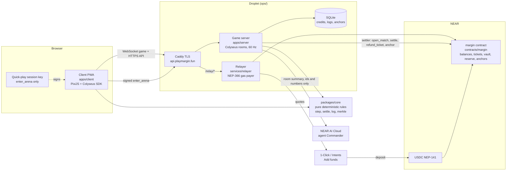
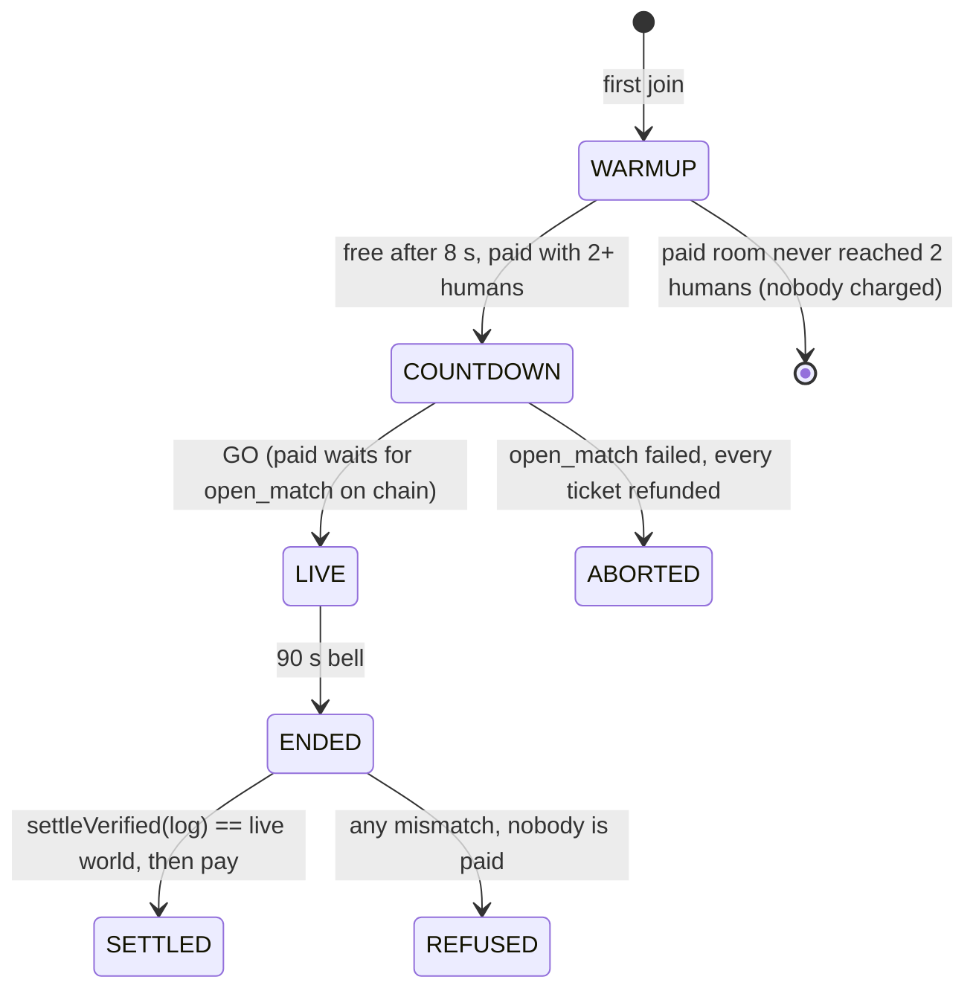

# MARGIN architecture

MARGIN is a real-time arena: BOOST is a loan from a vault, getting greedy gets you liquidated, and
every match is provable on NEAR. This page covers how the parts fit, how a match runs, where money
moves, and what each party can and cannot do. Every claim points at code you can read.

## Components

The same `packages/core` code runs the match on the server, replays it on the Verify page in the
browser, and powers `npm run demo` and `npm run sim`.

## Game server and ops (S2)

### Rooms
- `match`: public, grouped by `mode` (`free` or `paid`).
- `private`: grouped by `mode` plus a 4-letter code.
- `judge`: one human against the published Judge Run scenario (`JUDGE_SEED`).

All three share one class, `apps/server/src/rooms/MatchRoom.ts`. It is a thin shell around core: it
handles sockets, timers, credits, the log, and settlement.

### Match lifecycle

1. **WARMUP** is the lobby. Blobs are ghosts and nothing is charged. Leaving is free.
2. **COUNTDOWN** (3-2-1) locks the room.
   - Free rooms fill the empty seats with labelled agents (`Agent-N 🤖`).
   - Paid rooms add `min(3, ceil(humans/3))` labelled liquidator drones.
   - Paid rooms call `open_match` now. That binds each player's ticket and reserves the vault budget.
   - The paid roster is final from here: a player who leaves stays in the match.
3. **GO / LIVE**: the server charges entry and core respawns everyone at seeded, evenly spaced
   points.
   - Every tick runs the same steps: inputs in, agent brains, `step()`, then events out.
   - Free rooms accept late joins for 15 s.
   - The log is saved every 5 s.
4. **ENDED**: core replays the whole hash-chained log (`settleVerified`). Every payout must equal
   the live world exactly, otherwise the match is marked `refused` and nobody is paid.
5. **SETTLED**:
   - Free rooms credit the ledger.
   - Paid rooms call `settle` on the contract, with the log head inside the transaction.
   - Free match heads go into an hourly Merkle root, anchored with `anchor("free", hour, root)`.

A disconnected blob stays in the arena: its input expires after 250 ms and it can still be popped.
The player can reconnect until the match ends. On a deploy the server drains: new rooms are refused,
LIVE matches finish and settle first, and systemd waits up to 120 s.

### Money flow

| Mode | Where value lives | In | Out |
|---|---|---|---|
| Free | `credits_ledger` in SQLite (append-only, enforced by triggers) | daily top-up to 1,000 credits | entry 100 at GO, payout at settle |
| Paid | the contract (USDC base units) | deposit (USDC or 1-Click) becomes the idle balance, then `enter_arena` turns it into a 1 USDC ticket | `settle` pays the match's players, repays the vault and adds the reserve share |

- **Units.** All game money is integer Micro: 1 unit is 1,000,000 Micro, and 1 USDC is 100 units.
  Percentages are basis points.
- **Rounding.** `toSettleArgs` (`apps/server/src/settlement/toSettleArgs.ts`) rounds every amount
  down to USDC base units, and the reserve takes the remainder. The contract's exact conservation
  check therefore always holds. This is tested on 2,000 random splits.
- **Bad debt.** It is capped at 10% of the match budget. Anything above that is repaid to the vault
  out of the largest payouts.
- **Drone bounties.** Drones have no account, so their bounties go to the reserve.
- **No survivors.** If nobody survives, the leftover pot goes to the vault.

### Trust boundaries

| Party | Can | Cannot (enforced by) |
|---|---|---|
| Player (browser) | send inputs (dir, BOOST, REPAY, cash out) | change rules or positions: `parseInput` validates every message, 30 a second per player, and the server is authoritative |
| Player (paid join) | join a paid room with its own ticket | play someone else's ticket. The NEP-413 signature over `margin-join:paid:<account>` must come from a key of that account scoped to the contract. Nonces are single-use within 60 s. One live room per account (`paidMatch.ts`) |
| Session key | `enter_arena` only | withdraw: `withdraw` needs 1 yoctoNEAR, which a function-call key cannot attach |
| Game server (settler key) | `open_match`, `settle`, `refund_ticket`, `anchor` | create money (exact conservation), pay anyone outside the match, overspend the reserved budget or the 10% bad debt cap, settle twice, roll an anchor back (seq must grow), touch idle balances or the vault (owner only) |
| Game server (outcomes) | run the simulation | hide what happened: the full hash-chained log is public (`GET /api/matches/:id/log`). Anyone can replay it with core on `/verify` and compare the head with the settle transaction or the Merkle proof (`/api/matches/:id/proof`) |
| Relayer | pay gas for allow-listed calls, fund new email-login accounts (daily cap) | sign for players. It only wraps a gas-capped, zero-deposit `enter_arena` signed by the player (`services/relayer/validate.ts`) |
| NEAR AI Commander | retune agent personalities (greed, caution, drone focus) | move a blob or touch money: it gets only ids and numbers, and its output is parsed and clamped (`apps/server/src/agents/commander.ts`) |
| Operator | run the droplet, withdraw from the vault and reserve as owner | block refunds: players `reclaim()` their stake 15 min after a match opens if it never settles |

Server abuse limits:
- 12 joins a minute per IP.
- 30 `/api/credits` calls a minute per IP.
- `MAX_ROOMS` live rooms (default 100).
- Caddy sets the client IP header, so a client cannot spoof it.

### Read API
| Route | Returns |
|---|---|
| `GET /health` | network, contract, rooms, memory, tick timings (503 while draining) |
| `GET /api/matches/:id/log` | `{log, anchorHead, tx, network, status}` for the Verify page |
| `GET /api/matches/:id/proof` | paid: settle tx. free: Merkle proof to the hourly anchor |
| `GET /api/leaderboard` | NEAR accounts only, net result over the last 24 h, top 20 |
| `GET /api/stats` | users, players, settled matches, % with 2+ humans, liquidations by agents |
| `GET /api/credits?guestKey=` | free credits balance (applies the daily top-up) |

### Deploy and operations
One droplet runs Caddy, the game server and the relayer as systemd units. Both restart automatically,
logs are JSON lines, and the steps are in `ops/README.md`. A 50-match local soak gave a 60 Hz tick
p99 of 0.3 ms and peak memory of 227 MB. `npm run e2e:local` plays a full match against the real
server in CI.

## Core rules and agents (S1)
_To be written by S1: tick order, economy, hash-chained log, settle, agents and drones._

## Client (S3)
_To be written by S3: rendering, prediction and interpolation, screens, Verify page._

## Contract, relayer and Intents (S4)
_To be written by S4: contract state and methods, ticket model, relayer policy, 1-Click flow._
